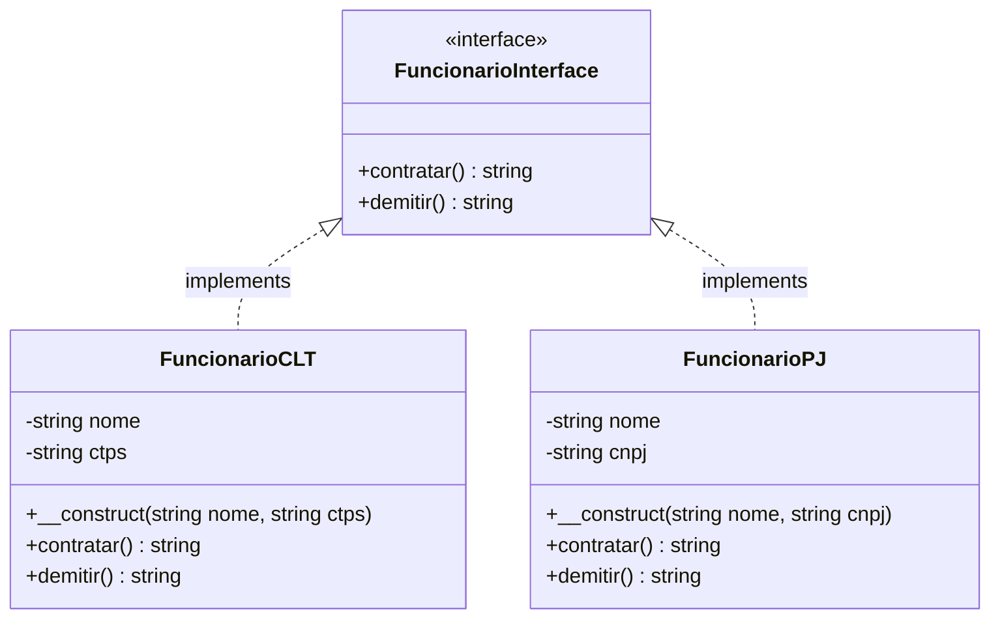

# Diagrama de Classes - Funcionários (Interface)

## Classe abstrata vs. Interface: 
A classe abstrata é um molde base (com código pronto) e você só herda uma. A interface é só um contrato de regras obrigatórias e você pode usar várias.

## Trabalho em equipe: 
A interface cria um padrão combinado antes. Assim, cada pessoa programa a sua parte separada sem brigar e, no final, tudo se encaixa perfeitamente sem erros.

## Como interfaces ajudam ele a entender o sistema mais rápido?
Ela funciona tipo um sumário de livro ou o menu de um restaurante. Você não precisa ler 500 linhas de código complicado pra descobrir o que uma classe faz; só batendo o olho na interface você já vê direto os botões disponíveis e o que o sistema entrega.

## O que acontece se ele não seguir o contrato?
O PHP trava tudo e dá erro fatal na hora. Se você prometeu que a classe ia seguir a interface (usando `implements`), mas esqueceu de fazer algum método ou escreveu o nome errado, o programa nem liga ele já te barra avisando o que ficou faltando.